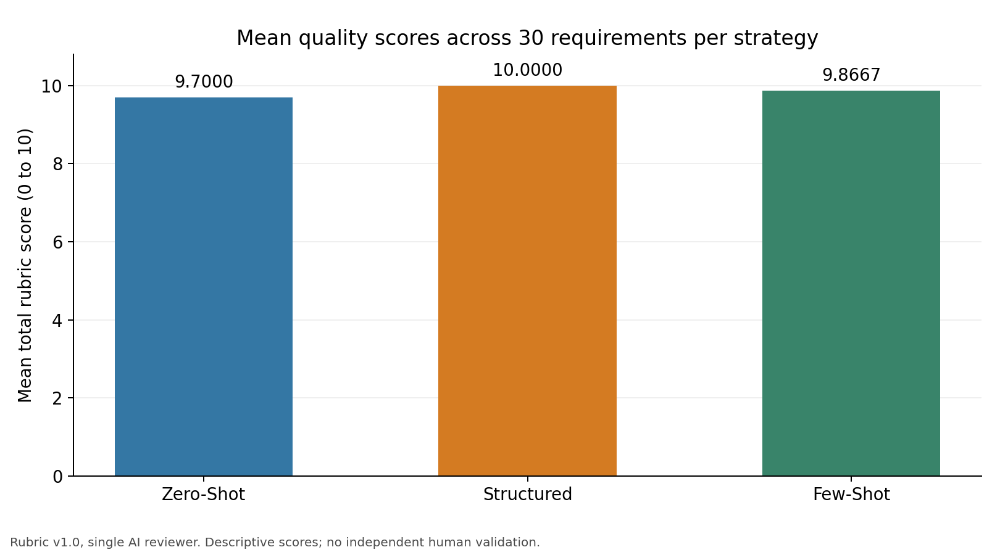

# LLM-Based Software Requirement-to-Test-Case Generator for Embedded Systems

## Project Overview

Software requirements are commonly written in natural language, while
software engineers must translate those requirements into detailed and
testable test cases. This process can require significant manual effort
and may result in missed conditions, boundary cases, or inconsistent
test coverage.

This project investigates whether Large Language Models (LLMs) can
assist software engineers by automatically converting natural-language
software requirements into structured test cases for embedded systems.

The project focuses on generating test cases in **Given-When-Then**
format and experimentally comparing different prompting strategies.

## Problem Statement

Creating software test cases from requirements is an important but
time-consuming part of software development. Engineers must understand
each requirement, identify preconditions and triggering conditions,
determine the expected system behavior, and consider relevant boundary
or negative cases.

Embedded-system requirements often describe behavior that depends on
system states, sensor values, thresholds, timing conditions, and
interactions between components. Missing or incorrectly interpreting one
of these conditions can lead to incomplete test coverage.

The main research question is:

> **How effectively can Large Language Models generate structured and
> accurate test cases from natural-language software requirements for
> embedded systems?**

A secondary research question is:

> **Do structured and few-shot prompting strategies improve the quality
> and consistency of generated test cases compared with a basic
> zero-shot prompt?**

## Proposed Method

The project uses a Python-based prototype that accepts natural-language
software requirements and uses an LLM to generate structured test cases.

### Workflow

**Software Requirement → LLM Prompt → Test Case Generation → Structured
Given-When-Then Output → Evaluation**

Example input:

> When the battery state of charge (SOC) falls below 10% while the
> vehicle is in Drive, the system shall display a low-battery warning.

Example expected output:

-   **Given:** The vehicle is in Drive and battery SOC is at or above
    10%.
-   **When:** Battery SOC falls below 10%.
-   **Then:** The system displays the low-battery warning.

## Prompting Strategies

The experiment compares three prompting strategies while keeping the
requirement dataset, model, and output format consistent.

### 1. Zero-Shot Prompt

The LLM is directly asked to generate a Given-When-Then test case
without receiving example test cases.

This strategy provides the experimental baseline.

### 2. Structured Prompt

The LLM receives additional instructions for identifying:

-   Required initial states and preconditions
-   Specific triggering events or transitions
-   Expected system behavior
-   Threshold and timing conditions
-   Unsupported assumptions or behaviors that should not be introduced

The goal is to determine whether explicit reasoning structure improves
the generated test cases.

### 3. Few-Shot Prompt

The LLM is provided with several example requirement-to-test-case pairs
before processing a new requirement.

The goal is to determine whether examples improve the consistency and
quality of the generated Given-When-Then structure.

## Dataset

The project uses a **synthetic dataset of 30 embedded-system software
requirements** created specifically for this experiment.

The dataset is balanced by difficulty:

  Difficulty     Requirements
  ------------ --------------
  Easy                     10
  Medium                   10
  Hard                     10
  **Total**            **30**

The requirements cover representative embedded-system behaviors
including system states and transitions, thresholds, warnings, timing,
I/O, charging, energy management, thermal management, diagnostics,
communication, safety interlocks, and sensor plausibility.

Each requirement contains a manually prepared reference test case
consisting of `reference_given`, `reference_when`, and `reference_then`.
These references are not provided to the LLM during generation and are
used only for evaluation.

The project does **not use proprietary, confidential, or
company-specific software requirements or source code**.

## Experimental Design

The same 30 requirements will be processed using each of the three
prompting strategies.

``` text
                         30 Requirements
                               |
              +----------------+----------------+
              |                |                |
              v                v                v
          Zero-Shot        Structured       Few-Shot
          30 Tests          30 Tests         30 Tests
              |                |                |
              +----------------+----------------+
                               |
                               v
                       90 Generated Tests
                               |
                               v
                           Evaluation
```

## Evaluation Criteria

Generated test cases will be compared with the manually prepared
reference test cases using:

1.  **Precondition Correctness**
2.  **Trigger Correctness**
3.  **Expected Behavior Correctness**
4.  **Condition / Boundary Coverage**
5.  **Unsupported Behavior / Hallucination**

The same evaluation criteria will be applied to all prompting
strategies. Quantitative results will be supplemented with qualitative
analysis of representative successful and unsuccessful generations.

**Rubric version 1.0 is finalized:** see [evaluation/rubric.md](evaluation/rubric.md)
for the scoring anchors, interpretation rules, and reference-test cautions.
Each criterion receives 0 (fails), 1 (partial), or 2 (fully satisfies), with
equal weights and a total score from 0 to 10. Higher is better for every
criterion: unsupported behavior receives 2 when no unjustified behavior appears.

The original requirement is authoritative; reference tests are comparison aids.
Valid alternative scenarios and paraphrases are accepted. Condition/boundary
coverage measures fidelity within one generated scenario, not exhaustive suite
coverage. The rubric addresses ambiguous logical conditions and assumptions in
the references, including REQ-023 and REQ-030.

[evaluation/rubric.json](evaluation/rubric.json) provides the common machine-readable
configuration. [evaluation/review_plan.json](evaluation/review_plan.json) assigns
that single version to all 90 requirement/strategy pairs and pins their source
hashes. All 90 reviews are now complete in
[evaluation/reviews.json](evaluation/reviews.json), with five scores, criterion-level
rationales, reference notes, and exact evidence snapshots per case. These are
unblinded, single-reviewer AI-generated judgments without independent human validation.

## Current Experimental Results

### Zero-Shot Baseline

The initial Zero-Shot experiment has been completed using **GPT-5.6**.

**30 of 30 requirements were successfully processed.**

Initial review indicates that most generated tests correctly identify
the precondition, trigger, and expected behavior. Some multi-condition
requirements produced valid tests but placed triggering conditions in
the Given statement rather than clearly identifying the primary
transition in the When statement.

These cases will be compared with Structured and Few-Shot results to
determine whether additional prompting guidance improves test-case
structure.

All three strategies have now been scored under the same rubric. The quantitative
summary below describes this dataset and AI review, not independently verified accuracy.

### Structured Prompting

Structured Prompting has been implemented and run on the same 30 requirements
using `gpt-5.6`, the same system instruction, and the same JSON output format.
The prompt explicitly separates preconditions, triggering events, and expected
behavior, while preserving guards, thresholds, timing, and logical conditions.

- **Sample check: 4 of 4 successful** across Easy, Medium, and Hard requirements.
- **Full run: 30 of 30 successful**, saved to `results/structured_results.csv`.
- All 30 IDs match the dataset; generated fields are nonempty.
- The Zero-Shot baseline file remains unchanged.
- These checks confirm generation completion, not measured accuracy.

See `experiments/structured_run.md` for the sample selection, execution settings,
and verification record.

### Few-Shot Prompting

Few-Shot Prompting has been implemented using four independently authored
requirement/test-case demonstrations in `data/few_shot_examples.json`. They
cover threshold crossing, a guarded event with a response deadline, a sustained
condition, and an inhibited request. They are separate from the 30 evaluation
requirements and do not use their reference answers.

- **Sample check: 4 of 4 successful**, using the same sample IDs as Structured.
- **Full run: 30 of 30 successful**, saved to `results/few_shot_results.csv`.
- Same model argument (`gpt-5.6`), system instruction, API settings, and output format.
- All 30 IDs match the dataset; generated fields are nonempty.
- Both earlier result files and the evaluation dataset remain unchanged.
- Ten offline regression tests pass, including reference-answer exclusion and
  normalized overlap rejection before applying a sample limit.

**All 90 planned requirement/strategy outputs are now saved.** This confirms
generation completion, not measured accuracy. Common-rubric scoring is now complete;
tables, charts, paired comparisons, and sensitivity checks are also complete.
See `experiments/few_shot_run.md` for the generation record and the evaluation
and analysis sections below for the scored results.

### Rubric-Based Evaluation Results

All 90 outputs were reviewed against rubric v1.0 and compared with the manual
references, treating the original requirement as authoritative. The review is
AI-generated, unblinded, and has no independent human validation. Scores measure
single-scenario quality under this rubric, not test-suite completeness or a
validated accuracy/pass rate.

| Strategy | Scored | Mean score /10 | Full score /30 |
| --- | ---: | ---: | ---: |
| zero_shot | 30/30 | 9.7000 | 26 |
| structured | 30/30 | 10.0000 | 30 |
| few_shot | 30/30 | 9.8667 | 29 |

Representative findings:

- REQ-002 and REQ-013 preserve their guarded threshold and response deadline.
- Zero-Shot REQ-018 needs clearer Given/When separation and adds an incidental
  processing step absent from the requirement.
- Zero-Shot and Few-Shot REQ-023 incorrectly guarantee acceptance from necessary
  conditions, agreeing with an unsupported assumption in the manual reference.
- Structured REQ-023 correctly rejects a command aged exactly 100 ms.
- Structured receives full credit on all cases in this review; the resulting
  ceiling does not establish exhaustive coverage or broad superiority.

Artifacts: [case scores](results/evaluation_scores.csv),
[exact summary statistics](results/evaluation_summary.json), and
[evaluation report with examples and limitations](results/evaluation_report.md).
The evaluator validates provenance and computes aggregates; semantic ratings are
authored judgments stored separately in `evaluation/reviews.json`.

Recompute results offline:

```bash
python src/evaluator.py
```

All 28 offline tests pass. Generation outputs, source requirements, rubric anchors
and weights remain unchanged. A display-label repair in `rubric.json` is recorded
in `review_plan.json`; it does not change the scoring policy.

### Analysis and Visualization

[Analysis report](results/analysis/analysis_report.md) provides the strategy,
criterion, difficulty, unsupported-addition, paired-comparison, and sensitivity
results. It includes eight CSV tables and five figures, each available as PNG
and vector SVG under [results/analysis/charts](results/analysis/charts).



Key findings from these single-reviewer AI ratings:

- Structured exceeds Zero-Shot on 4 requirements and ties on 26; the mean paired
  difference is +0.3000 points out of 10.
- Few-Shot exceeds Zero-Shot on 3 requirements and ties on 27; its mean paired
  difference is +0.1667 points.
- Structured and Few-Shot tie on 29 requirements. Their +0.1333 mean difference
  comes entirely from REQ-023; removing it for sensitivity analysis makes them tie.
  The primary results retain all 30 requirements.
- Zero-Shot REQ-018 accounts for the only partial trigger score. Zero-Shot and
  Few-Shot REQ-023 account for both expected-behavior score-0 cases and both
  material unsupported-addition ratings.
- All 90 condition/boundary scores are 2/2. This ceiling concerns one-scenario
  fidelity; it does not demonstrate exhaustive boundary coverage.
- Unsupported additions are separated by severity: Zero-Shot has 3 minor and
  1 material, Structured has none, and Few-Shot has 1 material addition.

These differences depend on a few judgments, including assumptions in the manual
reference tests. They do not establish statistical significance, independently
validated accuracy, or broad strategy superiority.

Recreate the analysis without API calls, in an environment with Matplotlib:

```bash
python -m pip install -r requirements-analysis.txt
python src/analyze_results.py
```

The analysis validates source fingerprints and preserves all ratings and generation
files. Three analysis tests check ID-based pairing, incomplete-pair rejection,
and leave-one-requirement-out arithmetic; the full suite has 28 passing tests.

## Expected Outcome

The expected outcome is a working prototype demonstrating how an LLM can
assist with converting software requirements into structured test cases.

The project will compare Zero-Shot, Structured, and Few-Shot prompting
and identify situations in which generated test cases are accurate and
useful, as well as cases where they may be incomplete, poorly
structured, or introduce unsupported assumptions.

The local interactive demonstration accepts requirement input, supports all
three prompting strategies, and displays Given-When-Then output. It can replay
the saved experiments without an API connection or generate a new case using
a server-side API key.

## Technologies

-   Python
-   OpenAI LLM API
-   GPT-5.6
-   CSV-based experiment datasets
-   Python scripts for generation and evaluation
-   Git and GitHub
-   Local browser demonstration with Python HTTP server and HTML/CSS/JavaScript

## Running the Generator

Run commands from the repository root using a Python environment with the
`openai` package installed (`python -m pip install -r requirements.txt`).
Set `OPENAI_API_KEY` privately in that environment.
Do not commit or display the key.

```bash
python src/generator.py --strategy zero_shot
python src/generator.py --strategy structured
python src/generator.py --strategy few_shot
```

The default model remains `gpt-5.6`. All three strategies use the same system
instruction, API call, JSON format, and requirement dataset. Only the task
prompt changes. Evaluation reference fields are excluded from all prompts. Few-Shot adds four
independently authored demonstrations from `data/few_shot_examples.json`; they
are separate from the 30 evaluation requirements. The loader rejects duplicate
examples and case/whitespace-normalized overlap with the full input dataset,
including rows outside `--limit`. This is a text-overlap safeguard, not a general
semantic similarity detector.

Without `--output`, results go to `results/<strategy>_results.csv`
according to the selected strategy.
Omitting `--strategy` preserves the Zero-Shot default. A run replaces its
output file, so use a separate path for sample runs:

```bash
python src/generator.py --strategy structured --limit 3 --output experiments/structured_quick_check.csv
python src/generator.py --strategy structured --input experiments/structured_sample_requirements.csv --output experiments/structured_sample_results.csv
python src/generator.py --strategy few_shot --input experiments/few_shot_sample_requirements.csv --output experiments/few_shot_sample_results.csv
```

The second and third commands reproduce the four-requirement sample selection
(REQ-002, REQ-018, REQ-021, REQ-030), covering all difficulty levels.
New API calls may produce different wording. API usage may incur charges.

Offline regression checks:

```bash
python -m unittest discover -s tests -v
```

## Interactive Demonstration

Start the local browser interface from the repository root:

```bash
python -m pip install -r requirements.txt
python demo/app.py
```

Open [http://127.0.0.1:8765](http://127.0.0.1:8765). The default **Saved experiment**
mode replays all 30 requirements under any of the three strategies without an
API key. **Live API** accepts custom requirement text and uses the existing
prompts when `OPENAI_API_KEY` is set in the server environment before startup.
The app does not automatically load local key files. Live calls can incur charges.

The interface displays Given, When, Then, the strategy, model, and whether the
output is saved or newly generated. JSON downloads are separate from the frozen
experiment files. See [demo/README.md](demo/README.md) for setup, a two-minute
class walkthrough, and verification details.

Verification: all 28 Python tests pass, UI state checks pass with a DOM substitute,
and local HTTP smoke checks pass for the three saved strategies. Live requests
were tested with a mocked API; no new paid model calls were made. Browser preview
was unavailable, so rendered layout needs a user-side check.

## Final Report

The eight-page English [final report PDF](report/final_report.pdf) is prepared
with **Sangkook Kang** as author. It includes the academic report sections,
quantitative tables, three figures, qualitative examples, related work,
limitations, conclusions, citations, and an explicit AI-assistance disclosure.
Its rubric scores remain unblinded AI judgments without independent human validation.

The [editable Markdown source](report/final_report.md) and
[build instructions](report/README.md) are included. All eight rendered pages
were visually inspected, and reported numbers were checked against the saved
summaries. No generation outputs or review scores were changed.

```bash
python -m pip install -r requirements-report.txt
python report/plot_report_figure.py
python report/build_report.py
```

Review the report before submission. Creating it here does not submit it to Moodle.

## Repository Structure

``` text
requirement-test-generator/
├── README.md
├── data/
│   ├── requirements.csv
│   └── few_shot_examples.json
├── src/
│   ├── generator.py
│   ├── evaluator.py
│   └── analyze_results.py
├── experiments/
│   ├── structured_sample_requirements.csv
│   ├── structured_sample_results.csv
│   ├── structured_run.md
│   ├── few_shot_sample_requirements.csv
│   ├── few_shot_sample_results.csv
│   └── few_shot_run.md
├── results/
│   ├── zero_shot_results.csv
│   ├── structured_results.csv
│   ├── few_shot_results.csv
│   ├── evaluation_scores.csv
│   ├── evaluation_summary.json
│   ├── evaluation_report.md
│   └── analysis/
│       ├── analysis_report.md
│       ├── analysis_summary.json
│       ├── charts/              # Five PNG/SVG figure pairs
│       └── *.csv                # Eight analysis tables
├── evaluation/
│   ├── rubric.md
│   ├── rubric.json
│   ├── review_plan.json
│   └── reviews.json
├── demo/
│   ├── app.py
│   ├── index.html
│   ├── app.js
│   ├── style.css
│   └── README.md
├── requirements.txt
└── report/
    ├── final_report.pdf
    ├── final_report.md
    ├── build_report.py
    ├── plot_report_figure.py
    ├── figures/
    └── README.md
```

## Project Status

**Current Phase: Final Presentation and Submission Preparation**

Numbered tasks keep their original numbers when moved from Next Steps to Completed.

### Completed

-   [x] Defined the project problem and research questions
-   [x] Created the initial GitHub repository and README
-   [x] Created the synthetic embedded-system requirements dataset
-   [x] Reduced the experimental dataset to 30 requirements
-   [x] Balanced the dataset across Easy, Medium, and Hard requirements
-   [x] Created manual Given-When-Then reference test cases
-   [x] Implemented the Python LLM test-case generator
-   [x] Implemented the Zero-Shot prompting baseline
-   [x] Validated the generator using initial sample requirements
-   [x] Completed Zero-Shot generation for all 30 requirements
-   [x] Saved Zero-Shot experimental results

1.  **Implement Structured Prompting** — Completed
    -   [x] Added explicit instructions for separating preconditions,
        triggers, and expected behavior.
    -   [x] Tested on four requirements across all difficulty levels.
    -   [x] Ran all 30 requirements successfully.
    -   [x] Saved and checked `results/structured_results.csv`.
    -   [x] Passed five offline regression tests for strategy selection and prompt isolation.

2.  **Implement Few-Shot Prompting** — Completed
    -   [x] Created four independent example requirement/test-case pairs.
    -   [x] Excluded evaluation reference answers and checked demonstration overlap.
    -   [x] Tested on four sample requirements across all difficulty levels.
    -   [x] Ran all 30 requirements successfully.
    -   [x] Saved and checked `results/few_shot_results.csv`.
    -   [x] Passed ten offline regression tests across all strategies.

3.  **Finalize the Evaluation Rubric** — Completed
    -   [x] Defined 0/1/2 scoring anchors for all five criteria.
    -   [x] Fixed equal weights, score direction, and aggregation rules.
    -   [x] Documented valid alternatives, reference discrepancies, and boundary interpretation.
    -   [x] Assigned the same rubric version to all 90 outputs; scoring is recorded under task #4.

4.  **Evaluate the 90 Generated Test Cases** — Completed
    -   [x] Reviewed all 90 cases against the requirements and manual references.
    -   [x] Recorded 450 criterion scores with rationales, evidence, and reviewer metadata.
    -   [x] Calculated strategy/difficulty means and criterion score distributions.
    -   [x] Documented successful cases, structural weaknesses, and logical errors.
    -   [x] Preserved source artifacts and disclosed the unblinded AI-review limitations.
    -   [x] Implemented an offline evaluator; all 16 regression tests pass.

5.  **Analyze and Visualize Results** — Completed
    -   [x] Compared average scores and paired requirement-level differences.
    -   [x] Analyzed trigger and expected-behavior correctness with examples.
    -   [x] Analyzed condition/boundary ceilings and unsupported additions by severity.
    -   [x] Created eight tables and five charts in PNG and SVG formats.
    -   [x] Documented sensitivity checks and single-reviewer limitations.
    -   [x] Added reproducible analysis code; all 19 offline tests pass.

6.  **Develop the Demonstration** — Completed
    -   [x] Created a local browser interface with requirement input.
    -   [x] Added selection for Zero-Shot, Structured, and Few-Shot prompting.
    -   [x] Displayed Given/When/Then output with source and model metadata.
    -   [x] Added offline saved-result replay and JSON download.
    -   [x] Reused the generator for live requests without changing experiment files.
    -   [x] Passed 28 Python tests, UI state checks, and local HTTP smoke checks.
    -   Browser-rendered layout still needs a user-side check; preview was unavailable.

7.  **Prepare the Final Report** — Completed
    -   [x] Prepared an eight-page English academic report with Sangkook Kang as author.
    -   [x] Documented data, methods, experiments, results, limitations, and conclusions.
    -   [x] Included quantitative tables, three figures, and qualitative examples.
    -   [x] Added related work, citations, and AI-assistance acknowledgement.
    -   [x] Saved PDF and editable Markdown with reproducible build instructions.
    -   [x] Inspected all rendered pages and checked consistency with the saved results.

### Next Steps

8.  **Prepare the Final Presentation and Demo**
    -   Present the problem, solution, prompting strategies, results,
        and limitations.
    -   Demonstrate the working generator.

## Citations and Acknowledgements

- Brown et al. (2020), [Language Models are Few-Shot Learners](https://arxiv.org/abs/2005.14165).
- Yuan et al. (2023, revised 2024), [No More Manual Tests? Evaluating and Improving ChatGPT for Unit Test Generation](https://arxiv.org/abs/2305.04207).
- Cucumber, [Gherkin Reference](https://cucumber.io/docs/gherkin/reference/), for Given/When/Then terminology.
- OpenAI, [official Python API library](https://github.com/openai/openai-python), used for generation.
- Matplotlib, [project documentation](https://matplotlib.org/), used for analysis figures.
- ReportLab, [official documentation](https://docs.reportlab.com/), used to build the report PDF.
- PyMuPDF, [official documentation](https://pymupdf.readthedocs.io/en/latest/), used for PDF rendering and inspection.

The dataset and Few-Shot examples are synthetic project artifacts. Python and
its standard library support data processing, evaluation, tests, and the local demo.
Detailed references and access dates appear in the final report.

An OpenAI assistant helped with implementation, prompt and reference handling,
documentation, all 90 semantic ratings, analysis, and report preparation. The
AI-authored ratings have not received independent human validation. The report
names Sangkook Kang as project author without implying an independent correctness
review of the assistant's contributions.
