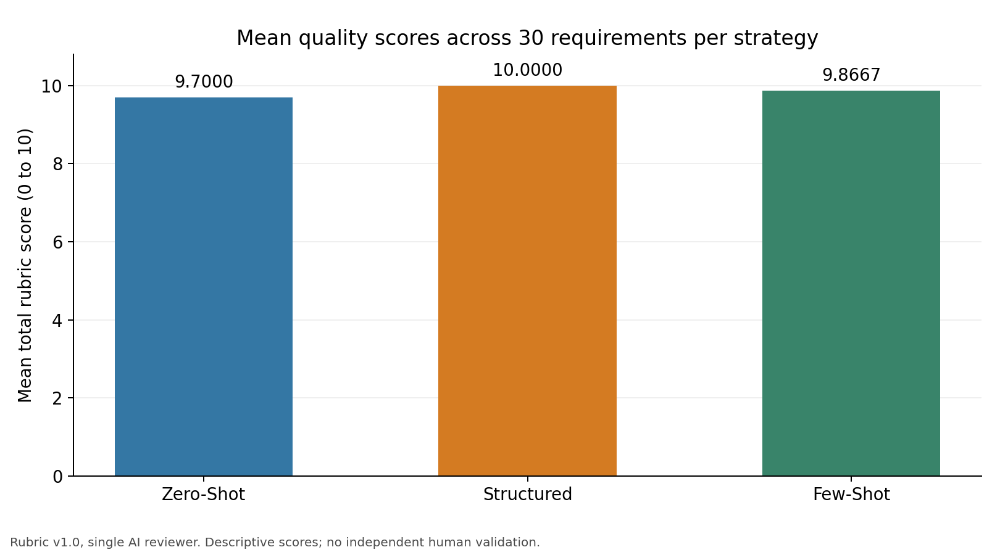
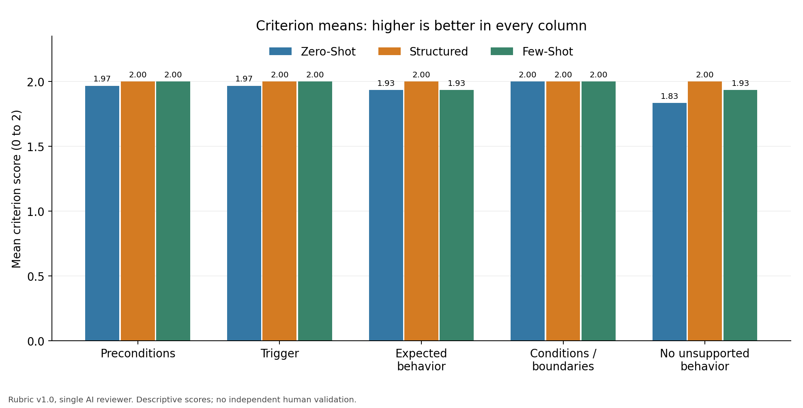
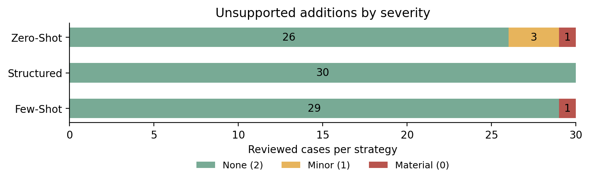

# LLM Based Requirement to Test Case Generation for Embedded Systems

**Sangkook Kang**

CSI-4130/5130 Artificial Intelligence Course Project

Final report prepared November 18, 2026

## Abstract

This project implements a Python prototype that converts synthetic embedded-system requirements into textual Given-When-Then test cases. It compares Zero-Shot, Structured, and Few-Shot prompting on the same 30 requirements, balanced across three difficulty levels. All 90 main experiment outputs were generated successfully. An unblinded AI reviewer applied five equally weighted criteria covering preconditions, triggers, expected behavior, condition and boundary fidelity, and unsupported additions. Mean total rubric scores were 9.7000/10 for Zero-Shot, 10.0000/10 for Structured, and 9.8667/10 for Few-Shot. These are descriptive reviewer judgments, not independently validated accuracy estimates. Structured and Few-Shot tied on 29 requirements; their entire mean difference arose from one necessary-versus-sufficient-condition error in REQ-023. A local browser demonstration supports saved-result replay and new generation. The main finding is that a small working prototype can produce reviewable test drafts, while reference quality, logical interpretation, and a single-scenario scoring ceiling substantially limit performance conclusions.

## 1 Introduction

Natural-language requirements describe intended behavior, but a test must identify an initial state, an event, and an observable response. Embedded-system examples often combine operating modes with thresholds, debounce durations, and response deadlines. Translating these details into a coherent scenario creates opportunities for omissions or unsupported assumptions. The present project examines LLM assistance with this translation, without claiming to replace engineering review.

The primary research question asks how effectively an LLM can generate structured tests from embedded-system requirements. The secondary question asks whether explicit field-separation instructions or worked examples improve the outputs relative to a basic prompt. The implemented contribution is a reproducible generation pipeline, a separate reference dataset, an auditable evaluation record, an analysis workflow, and a local demonstration. The outputs are textual scenarios, not executable hardware tests.

## 2 Related Work

Brown et al. demonstrate task specification through instructions and examples without gradient updates [1]. This motivates the Few-Shot condition; this project does not reproduce their model or benchmarks. Yuan et al. investigate ChatGPT unit-test generation, including correctness issues and an iterative refinement approach [2]. Their focus on generated unit-test code differs from the present requirement-to-scenario task, which does not compile tests or measure executed code coverage. Their findings motivate checking meaning rather than assuming readable output is correct.

Cucumber describes Given as context, When as an event, and Then as an expected outcome [3]. This project adopts that separation for reviewable JSON fields. It does not produce a complete Gherkin feature file or implement Cucumber step definitions. The study is a small application and prompting comparison, not evidence of a new model architecture or a comprehensive literature review.

<!-- pagebreak -->

## 3 Data and Experimental Design

The evaluation dataset contains 30 synthetic requirements in `data/requirements.csv`. Each row records an ID, category, difficulty, requirement text, and manual Given/When/Then reference. The difficulty groups contain ten requirements each. Categories include charging, diagnostics, thermal management, communication, warnings, and safety interlocks. These are illustrative scenarios; no company-specific requirements or confidential source code are used.

| Difficulty | Count | Representative content |
| --- | --- | --- |
| Easy | 10 | Threshold warnings and simple input/output events |
| Medium | 10 | Multiple guards, state transitions, and response timing |
| Hard | 10 | Debounce behavior, logical restrictions, and combined actions |
| Total | 30 | One manual reference per requirement |

The same requirements are used for all strategies. The comparison therefore contains 90 requirement/strategy pairs, with one saved main-run output per pair. Before the Structured and Few-Shot full runs, four sample requirements were checked: REQ-002, REQ-018, REQ-021, and REQ-030. Those preliminary outputs are separate artifacts, not additional unique evaluation cases or a repeated-trial study. No prompt changes followed those sample checks.

## 4 Methods and Implementation

### 4.1 Shared generation workflow

`src/generator.py` reads requirements, builds a prompt, calls the OpenAI Responses API through its Python SDK [4], parses JSON, and saves each result to a strategy-specific CSV. All strategies share the same system instruction, API call structure, and output keys: `given`, `when`, and `then`. Reference columns are excluded from every generation prompt. The file is checkpointed after each requirement, and errors are recorded separately.

The recorded model argument is `gpt-5.6`. This report uses that stored label, without asserting a verified model architecture or immutable provider snapshot. Sampling uses API/SDK defaults. Resolved model snapshots, random seeds, token costs, and latency measurements were not retained as controlled experimental variables. The study compares prompting configurations under this recorded setup, not different models.

### 4.2 Prompting conditions

| Strategy | Information added to the shared task |
| --- | --- |
| Zero-Shot | Requirement, task request, and JSON format; no worked examples |
| Structured | Seven rules for field separation, logic, timing, and avoiding inventions |
| Few-Shot | Four independent demonstrations before the baseline target task |

Few-Shot examples cover greenhouse humidity, a packaging actuator stop, sustained coolant-flow loss, and an inhibited irrigation request. They are newly authored examples rather than evaluation rows or copied reference answers. Their order is fixed across requests. The loader rejects duplicates and case/whitespace-normalized overlap against the full input dataset before applying a sample limit. This is a text-overlap check, not a detector of all semantic similarity. Shared test-design patterns are intentional.

<!-- pagebreak -->

## 5 Evaluation Protocol

### 5.1 Rubric and scoring direction

Rubric v1.0 assigns 0, 1, or 2 to each of five equally weighted criteria. A 2 fully satisfies the criterion for the chosen scenario, a 1 requires a local clarification or correction, and a 0 indicates a material failure. The total ranges from 0 to 10. Higher is better in every criterion, including unsupported behavior: a 2 means no unjustified addition. Scores are not converted into a validated pass/fail classification.

| Criterion | Main question |
| --- | --- |
| Precondition correctness | Does Given establish compatible initial conditions and required guards? |
| Trigger correctness | Does When identify the concrete event, transition, or elapsed condition? |
| Expected behavior correctness | Does Then preserve the required response, polarity, actions, and deadline? |
| Condition and boundary fidelity | Does the scenario retain relevant logic, bounds, counts, and timing? |
| Unsupported behavior | Does it avoid unjustified assumptions, outputs, or sufficient conditions? |

The original requirement is authoritative. References are comparison aids rather than unquestionable answers. Equivalent wording and valid alternative events receive credit. An initially unset fault or inactive output can be a compatible observation setup. An unnecessary restriction can lose one unsupported-behavior point, while an invented material response or logical sufficiency receives zero for that criterion.

Condition/boundary fidelity concerns the selected single scenario. It does not require an entire suite of positive, negative, and exact-boundary tests. A guard in the wrong field may retain semantic coverage credit while losing structural credit. Distinct criteria can penalize different aspects of the same error; those penalties are not independent observations.

### 5.2 Reviewer and traceability

One unblinded OpenAI assistant reviewed all 90 cases and authored 450 criterion scores and rationales. The assistant also helped implement the project and prepare its rubric. There was no independent human validation or inter-rater agreement measurement. The rubric followed generation and preliminary inspection, so the process is not preregistered. These facts constrain interpretation of the high scores.

`evaluation/reviews.json` contains the ratings, exact requirement/reference/output snapshots, reviewer metadata, and reference notes. `src/evaluator.py` checks completeness, score ranges, rationales, evidence consistency, and source fingerprints, then computes summaries. It does not independently judge semantics or run a separate model evaluator. The recorded display-name repair in `rubric.json` changed labels only; criterion IDs, anchors, weights, and the rubric document remained unchanged.

### 5.3 Analysis plan

Strategy means use all 30 cases. Difficulty means use ten cases per stratum. Paired differences join the same requirement ID across strategies. Unsupported additions are separated into minor and material categories. Leave-one-requirement-out summaries explore sensitivity without removing any case from the primary results. No significance tests, confidence intervals, or repeated-generation variation estimates are claimed.

<!-- pagebreak -->

## 6 Quantitative Results

### 6.1 Generation completion and total quality

All strategies have 30/30 successful generation records and 30/30 scored outputs. Generation success means that the request and parser completed; it is distinct from semantic correctness. The total-score means and full-score counts are shown below. A full score concerns rubric v1.0 and one scenario, not exhaustive coverage or real-world accuracy.

| Strategy | Scored | Mean total out of 10 | Full score cases |
| --- | --- | --- | --- |
| Zero-Shot | 30 | 9.7000 | 26 |
| Structured | 30 | 10.0000 | 30 |
| Few-Shot | 30 | 9.8667 | 29 |



### 6.2 Paired comparisons

| Comparison A minus B | Mean difference | A higher | Equal | A lower |
| --- | --- | --- | --- | --- |
| Structured minus Zero-Shot | +0.3000 | 4 | 26 | 0 |
| Few-Shot minus Zero-Shot | +0.1667 | 3 | 27 | 0 |
| Structured minus Few-Shot | +0.1333 | 1 | 29 | 0 |

Structured exceeds Zero-Shot on REQ-010, REQ-018, REQ-019, and REQ-023. Few-Shot exceeds Zero-Shot on the first three of these IDs. Structured and Few-Shot differ only on REQ-023. Thus, the ranking depends on a small number of judgments. The ceiling score for Structured should not be interpreted as proof of general superiority.

<!-- pagebreak -->

### 6.3 Criterion scores and unsupported additions

The mean trigger score is 1.9667/2 for Zero-Shot and 2.0000/2 for the other strategies. The mean expected-behavior score is 1.9333/2 for Zero-Shot and Few-Shot, versus 2.0000/2 for Structured. REQ-018 accounts for the only partial trigger score; REQ-023 accounts for both zero expected-behavior scores. All 90 condition/boundary scores are 2/2, giving this criterion no discriminating power in this dataset.



Zero-Shot has three minor unsupported-addition ratings and one material rating. Structured has none. Few-Shot has one material rating. The two material cases are the REQ-023 outputs, one under each affected strategy. An outcome can preserve its stated input constraints but still assert an unsupported response; this explains the separate condition and expected-behavior ratings.



### 6.4 Difficulty and sensitivity

Easy/Medium/Hard means are 9.9/9.6/9.6 for Zero-Shot, 10/10/10 for Structured, and 10/10/9.6 for Few-Shot. Excluding REQ-023 only for sensitivity analysis gives means of 9.8276, 10.0000, and 10.0000 respectively across 29 cases. The Structured/Few-Shot difference disappears. The primary comparison retains all 30 cases; this check does not establish a statistical effect or a monotonic relationship with difficulty.

<!-- pagebreak -->

## 7 Qualitative Analysis

### 7.1 Successful guarded threshold and response deadline

REQ-002 requires a low-battery warning when SOC falls below 10% while the vehicle is in Drive. Its saved Zero-Shot test places Drive and SOC at or above 10% in Given, the downward crossing in When, and the warning in Then. It receives 2 on every criterion. This illustrates a clear state/event/output mapping rather than evidence that every low-battery boundary is tested.

REQ-013 requires Active mode within 100 ms of a valid wake-up message in Sleep. All strategies preserve the sleeping precondition, valid message, and response deadline. A single case can retain a timing obligation without measuring actual execution time; no controller was exercised in this project.

### 7.2 Structural weakness in REQ 018

The charging requirement needs request receipt and successful connector locking. Its original text does not impose a unique locking/request order. The generated When fields differ:

| Strategy | Saved When field |
| --- | --- |
| Zero-Shot | The system processes the charging request |
| Structured | A charging request is received. |
| Few-Shot | A charging request is received and the connector is locked successfully. |

Zero-Shot already puts request receipt and lock success into Given. The reviewer assigns 1 to preconditions, 1 to the trigger, 2 to expected behavior, 2 to conditions, and 1 to unsupported behavior, totaling 7/10. The processing step is an incidental assumption, while the stated response still enables charging. The three deductions concern different aspects of one scenario and must not be presented as three independent failures. Both other strategies receive 10/10 under the accepted alternative-order rule.

### 7.3 Necessary and sufficient conditions in REQ 023

The requirement states: "The system shall accept a received command only if its checksum is valid and its message age is less than 100 ms." Acceptance therefore requires both conditions. Their satisfaction alone does not guarantee acceptance. Both Zero-Shot and Few-Shot assert acceptance for a valid/young command, matching the manual reference but introducing an unsupported sufficiency assumption. Each receives zero for expected behavior and unsupported behavior, with a 6/10 total.

Structured instead supplies a valid-checksum command aged exactly 100 ms and expects nonacceptance. This follows from the strict age bound and receives 10/10. The case shows why reference agreement cannot replace logical review. The reference should be corrected or explicitly qualified in future work; the frozen source file was retained for provenance.

### 7.4 Minor assumptions and valid alternatives

Zero-Shot REQ-010 adds that the system is operational, and REQ-019 adds knowledge of the current maximum torque. Each loses one unsupported-behavior point as an unnecessary restriction. By contrast, minimal setup that makes a new activation observable is permitted. In REQ-020, all strategies unlatch the belt at qualifying speed rather than cross the speed threshold while unlatched. Both event choices satisfy the conjunction and receive full credit.

<!-- pagebreak -->

## 8 Discussion and Limitations

### 8.1 What the evidence supports

The prototype demonstrates end-to-end generation of reviewable textual scenarios. Additional instructions or examples coincide with clearer REQ-018 outputs in this saved experiment, while Structured avoids the REQ-023 inference made by the other strategies. These observations answer the research questions only within the selected dataset, rubric, and reviewer. They do not establish a causal effect of prompting or a validated accuracy advantage.

The analysis also exposes weaknesses in the evaluation material itself. REQ-023's reference treats necessary conditions as sufficient; REQ-030's reference invents specific prerequisite examples. Using the requirement as the source of truth avoids rewarding these assumptions solely because a reference includes them. A larger study should review and repair references before generation and freeze the revised dataset independently.

### 8.2 Threats to validity

**Reviewer dependence and hindsight.** A single AI assistant helped construct the system, define the rubric, review the outputs, and write the analysis. Strategy labels were visible, and the rubric followed preliminary output inspection. Independent human ratings could alter minor-assumption decisions and even scenario interpretations. No agreement statistic is available.

**Dataset and sampling.** Thirty synthetic, mostly automotive-style requirements cannot establish performance on industrial specifications. Difficulty labels are project categories, not a validated scale. There is one main generation per requirement/strategy pair. Output variation, prompt-example order effects, and generalization are unmeasured.

**Measurement ceiling.** Every case has full single-scenario condition credit, and Structured has full total credit. This limits discrimination. The metric does not test all branches, executable assertions, physical timing, hardware behavior, or fault-detection ability. Full-score counts are not accuracy percentages.

**Overlapping penalties and reference ambiguity.** One logical mistake can affect expected behavior and unsupported behavior; one structural weakness can affect several criteria. Equal-weight totals summarize these dimensions but do not provide independent error counts. Reference defects and optional initial-state choices require reviewer judgment.

**Configuration and performance.** The stored model argument does not pin a resolved provider snapshot. Generation time, token cost, seeds, and repeated-trial uncertainty were not measured. The findings cannot support cost-effectiveness or speedup claims.

### 8.3 Demonstration and future work

The local browser demo accepts custom text in Live API mode and offers all three strategies. Saved mode replays the 90 recorded outputs without an API connection. It displays Given/When/Then and downloads separate JSON without modifying experiment files. Verification includes 28 Python tests, UI state checks with a DOM substitute, and localhost HTTP smoke tests. Browser visual preview was unavailable; the live route used mocks during demo checks rather than new paid requests.

Future work should prioritize independent reference review and blinded human scoring, then expand the requirement corpus and repeat generations. Multiple scenarios per requirement, executable test integration, and hardware validation would address questions outside this prototype.

## 9 Conclusion

The project delivers a functioning requirement-to-test prototype and an auditable 90-output prompting comparison. Structured has the highest recorded mean, but its difference from Few-Shot depends entirely on one requirement. The practical outcome is a tool for drafting and inspecting scenarios, with logical review and evaluator independence remaining essential before stronger performance claims.

<!-- pagebreak -->

## 10 Reproducibility and Artifact Availability

The source repository contains the dataset, prompt templates, four independent examples, generation CSVs, rubric, 90 evidence-backed reviews, quantitative summaries, charts, demo, and tests. Project findings in this report come from these local artifacts [6]. SHA-256 fingerprints in the review plan and analysis summary pin the underlying files. Tables and figures report the recorded scores without changing their semantic judgments.

Run the following commands from the repository root in an appropriate Python environment. Generation needs a privately configured API key and may incur charges; evaluation and analysis do not make model calls.

```bash
python -m pip install -r requirements.txt
python src/generator.py --strategy zero_shot
python src/generator.py --strategy structured
python src/generator.py --strategy few_shot
python src/evaluator.py
python -m pip install -r requirements-analysis.txt
python src/analyze_results.py
python demo/app.py
python -m unittest discover -s tests -v
node tests/test_demo_ui.js
```

The generation commands replace their output files and can produce different responses; do not use them merely to inspect the frozen experiment. The report can be rebuilt with `python report/build_report.py` after installing `requirements-report.txt`. Its editable source is `report/final_report.md`. The test and rendering checks validate implementation and document integrity, not the independence of the semantic ratings.

## References

[1] T. B. Brown et al. (2020). Language Models are Few-Shot Learners. arXiv:2005.14165. [Primary paper](https://arxiv.org/abs/2005.14165).

[2] Z. Yuan, Y. Lou, M. Liu, S. Ding, K. Wang, Y. Chen, and X. Peng (2023, revised 2024). No More Manual Tests? Evaluating and Improving ChatGPT for Unit Test Generation. arXiv:2305.04207v3. [Primary paper](https://arxiv.org/abs/2305.04207).

[3] Cucumber. Gherkin Reference. [Official documentation](https://cucumber.io/docs/gherkin/reference/). Accessed November 18, 2026.

[4] OpenAI. OpenAI Python API Library. [Official source repository](https://github.com/openai/openai-python). Project dependency: 2.48.0. Accessed November 18, 2026.

[5] Matplotlib project. Matplotlib documentation. [Project website](https://matplotlib.org/). Charts use 3.9.4. Accessed November 18, 2026.

[6] S. Kang. Project artifacts: `data/requirements.csv`, `src/generator.py`, `evaluation/rubric.md`, `evaluation/reviews.json`, and `results/analysis/analysis_summary.json`. Repository snapshot used for this report, November 18, 2026.

[7] ReportLab. ReportLab Documentation. [Official documentation](https://docs.reportlab.com/). PDF generation library. Accessed November 18, 2026.

[8] PyMuPDF. PyMuPDF Documentation. [Official documentation](https://pymupdf.readthedocs.io/en/latest/). PDF rendering and inspection library. Accessed November 18, 2026.

## Citations and Acknowledgements

OpenAI models and the OpenAI Python SDK support test generation [4]. Matplotlib produces the analysis figures [5]; ReportLab builds the report PDF [7], and PyMuPDF renders it for inspection [8]. Python and its standard library support data handling, evaluation, tests, and the local HTTP demo. No external requirement dataset is claimed.

An OpenAI assistant helped with implementation, prompt and reference handling, documentation, all 90 semantic ratings, analysis, and report preparation. AI-authored ratings were not independently validated by a human. Sangkook Kang is the named project author; this acknowledgement does not imply that the assistant's work or judgments received an independent human correctness review.
