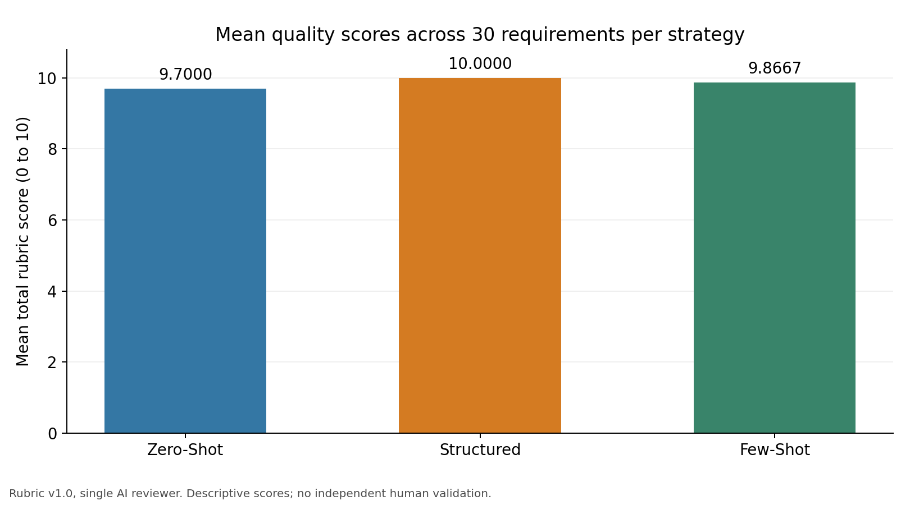
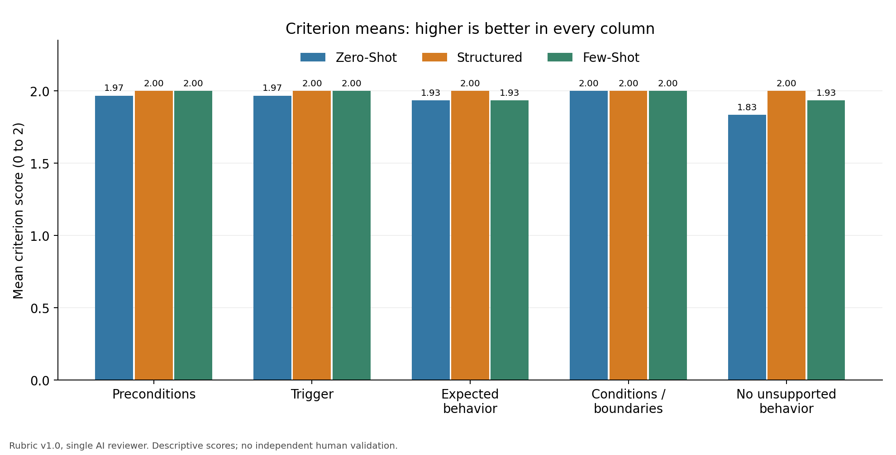
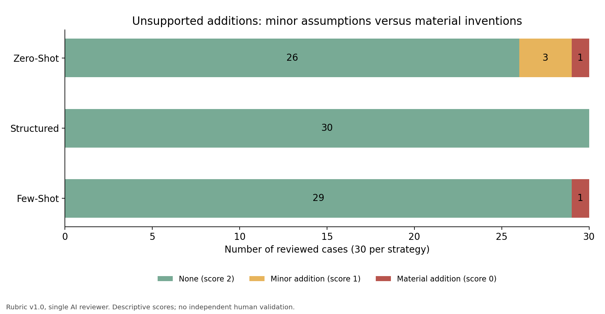
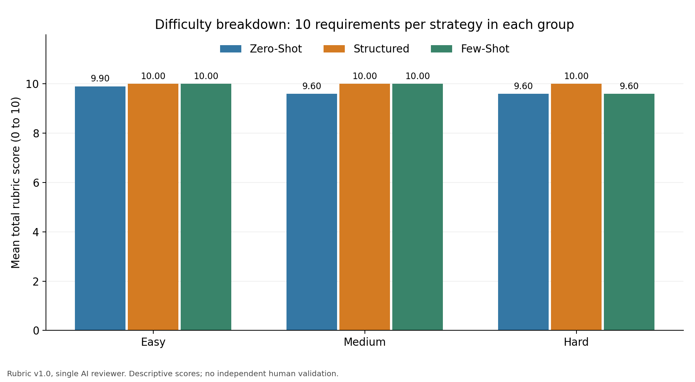
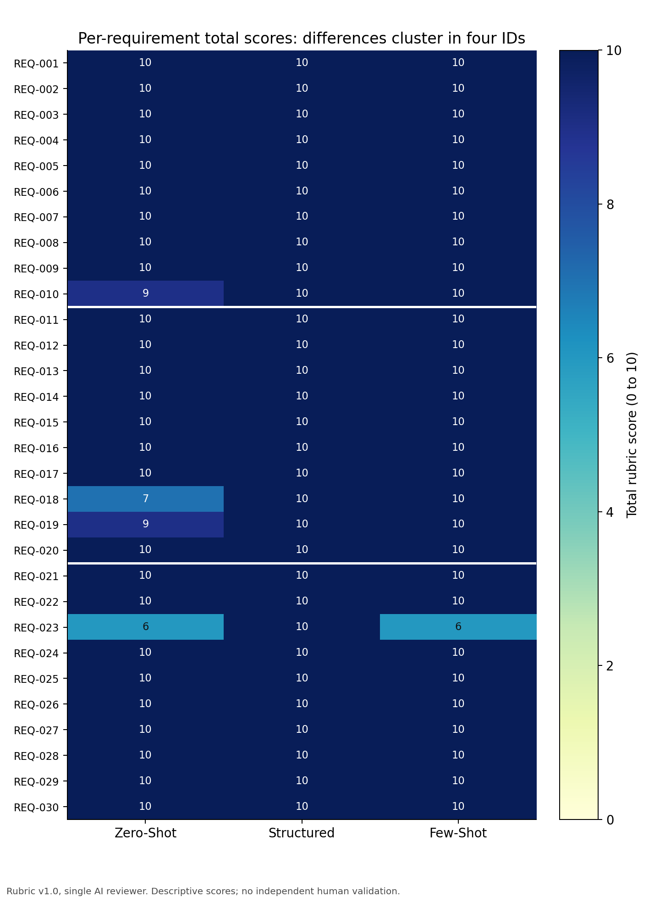

# Analysis and visualization

Rubric v1.0. All 90 cases are scored: 30 per strategy, with 10 per difficulty.

**Evidence scope:** Unblinded ratings from one AI reviewer, without independent
human validation. The reviewer also assisted with the implementation and rubric.
The rubric followed generation. This is descriptive analysis of these ratings,
not a validated accuracy estimate, causal comparison, or significance claim.

## Average quality and paired differences

| Strategy | Mean total /10 | Full-score cases /30 |
| --- | ---: | ---: |
| Zero-Shot | 9.7000 | 26 |
| Structured | 10.0000 | 30 |
| Few-Shot | 9.8667 | 29 |



| A minus B | Mean paired difference /10 | A higher | Equal | A lower |
| --- | ---: | ---: | ---: | ---: |
| Structured minus Zero-Shot | +0.3000 | 4 | 26 | 0 |
| Few-Shot minus Zero-Shot | +0.1667 | 3 | 27 | 0 |
| Structured minus Few-Shot | +0.1333 | 1 | 29 | 0 |

Pairing uses the same requirement ID, not unrelated samples. Structured exceeds
Zero-Shot on REQ-010, REQ-018, REQ-019 and REQ-023; the other 26 pairs tie.
Few-Shot exceeds Zero-Shot only on the first three of those IDs, while both
have the REQ-023 necessary/sufficient-condition error. Structured exceeds
Few-Shot only on REQ-023. Small score differences depend on a few judgments.

## Trigger and expected-behavior correctness

| Strategy | Trigger mean /2 | Trigger counts 0 / 1 / 2 | Expected mean /2 | Expected counts 0 / 1 / 2 |
| --- | ---: | --- | ---: | --- |
| Zero-Shot | 1.9667 | 0 / 1 / 29 | 1.9333 | 1 / 0 / 29 |
| Structured | 2.0000 | 0 / 0 / 30 | 2.0000 | 0 / 0 / 30 |
| Few-Shot | 2.0000 | 0 / 0 / 30 | 1.9333 | 1 / 0 / 29 |

Zero-Shot REQ-018 receives trigger score 1: request receipt is already in Given,
and When says only "The system processes the charging request". Structured
uses request receipt with successful locking established; Few-Shot uses a
joint request/locking event. Both alternatives are accepted by the rubric.

Zero-Shot and Few-Shot REQ-023 each receive expected-behavior score 0.
A valid checksum and age below 100 ms are necessary for acceptance, but the
requirement does not guarantee acceptance whenever they hold. The reference
makes the same unsupported inference. Structured instead rejects at exactly
100 ms, which follows from the strict age limit.



## Condition/boundary fidelity and unsupported additions

| Strategy | Conditions mean /2 | Full condition score /30 | No unsupported mean /2 | None | Minor | Material |
| --- | ---: | ---: | ---: | ---: | ---: | ---: |
| Zero-Shot | 2.0000 | 30 | 1.8333 | 26 | 3 | 1 |
| Structured | 2.0000 | 30 | 2.0000 | 30 | 0 | 0 |
| Few-Shot | 2.0000 | 30 | 1.9333 | 29 | 0 | 1 |

Every case receives condition/boundary score 2. This criterion measures fidelity
within the chosen single scenario, not coverage of every boundary or negative
branch. It therefore has no discriminating power in this dataset. In REQ-023,
correctly stated input constraints can receive condition credit even while the
asserted acceptance fails expected behavior and unsupported-behavior criteria.

The rubric defines unsupported behavior in the reverse direction to severity:
2 means none, 1 a minor addition, and 0 a material invention. Zero-Shot has
minor additions in REQ-010 (system operational), REQ-018 (incidental processing
step), and REQ-019 (known current torque). Both material additions occur on
REQ-023, one in Zero-Shot and one in Few-Shot. These are overlapping criterion
penalties for the same logical error, not independent hallucination events.

The three REQ-018 penalties likewise reflect different aspects of one scenario:
misplaced receipt, vague When, and an unsupported processing assumption. Totals
should be read alongside these criterion-level reasons.



## Difficulty and concentration of score losses

| Strategy | Easy /10 | Medium /10 | Hard /10 |
| --- | ---: | ---: | ---: |
| Zero-Shot | 9.9000 | 9.6000 | 9.6000 |
| Structured | 10.0000 | 10.0000 | 10.0000 |
| Few-Shot | 10.0000 | 10.0000 | 9.6000 |



Zero-Shot loses 9 of 300 possible points: REQ-010 loses 1, REQ-018 loses 3,
REQ-019 loses 1, and REQ-023 loses 4. Few-Shot loses 4 points, all on REQ-023.
Structured loses none. This does not establish a monotonic difficulty effect:
there are only 10 synthetic cases per level and one output per case.



## Sensitivity to one requirement

A leave-one-requirement-out table is supplied for all 30 IDs. It does not
replace the primary 30-case results. Excluding REQ-023 for illustration gives:

| Strategy | Primary mean /10 (n=30) | Mean excluding REQ-023 (n=29) |
| --- | ---: | ---: |
| Zero-Shot | 9.7000 | 9.8276 |
| Structured | 10.0000 | 10.0000 |
| Few-Shot | 9.8667 | 10.0000 |

The Structured/Few-Shot difference disappears without REQ-023. That makes its
logical interpretation and reference defect especially important for human
review. No outlier is removed from the primary analysis, and no significance
test or confidence interval is inferred from this deterministic sensitivity check.

## Conclusions supported by this review

- Structured has the highest recorded mean, but only four paired differences
  separate it from Zero-Shot and only one separates it from Few-Shot.
- Trigger structure improves in the REQ-018 examples; the main expected-behavior
  failure is the REQ-023 logical implication, not a missing output field.
- Condition/boundary scores show a ceiling for all strategies. Full credit for
  one scenario says nothing about exhaustive test generation or hardware coverage.
- Independent human review, especially of REQ-023 and the minor-assumption
  ratings, is the strongest next check before claiming a performance advantage.
- More independent requirements and repeated generations would be needed to
  study generalization and output variation. Neither is measured here.

## Artifacts and reproduction

- `analysis_summary.json`: exact analysis, paired deltas and source fingerprints.
- `strategy_comparison.csv`, `difficulty_comparison.csv`: mean-score tables.
- `criterion_distributions.csv`: all 45 criterion/strategy/score counts.
- `unsupported_additions.csv`: counts separated by severity.
- `paired_comparisons.csv`, `paired_differences.csv`: joined ID comparisons.
- `score_loss_cases.csv`: every case below the maximum.
- `leave_one_requirement_out.csv`: all 30 exclusion summaries.
- `charts/`: five figures, each in PNG and editable vector SVG formats.

From the repository root, use an environment with Matplotlib installed:

```bash
python -m pip install -r requirements-analysis.txt
python src/analyze_results.py
```

No model calls or API credentials are needed. The script validates the frozen
ratings and source hashes before plotting, checks the stored evaluation summary
for consistency, and leaves requirements, generated outputs and reviews unchanged.
